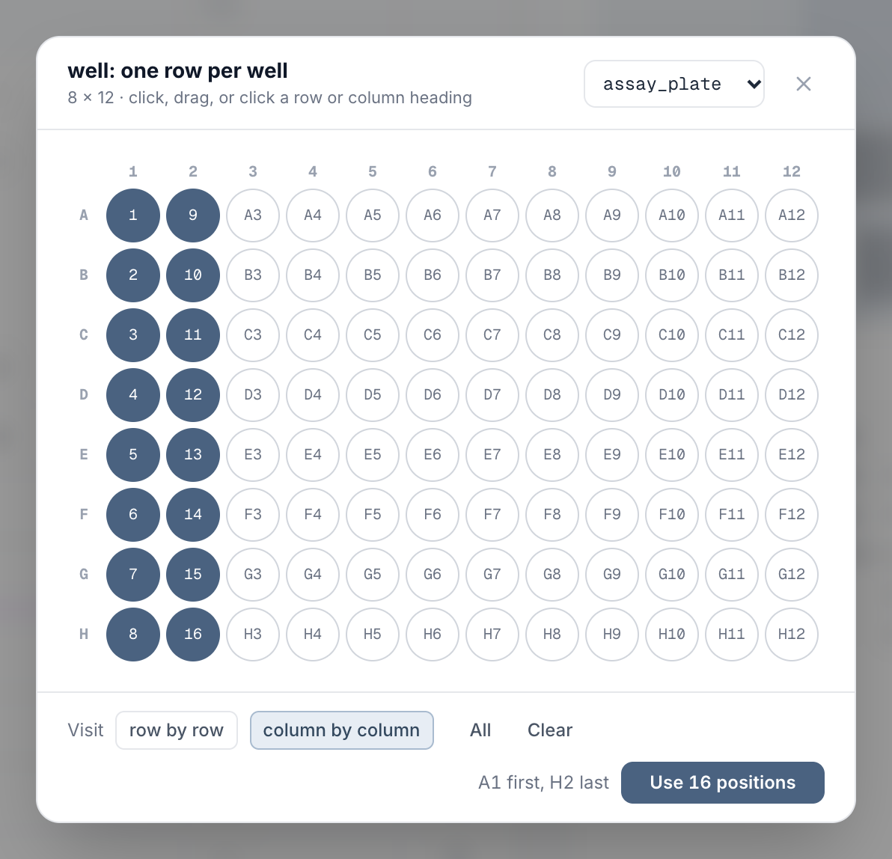

# plr-ivoryos

[](https://pypi.org/project/plr-ivoryos/)


> [!NOTE]
> **This is a third-party integration package.** It is not the official PyLabRobot library. For the official PyLabRobot repository, please visit [PyLabRobot](https://github.com/PyLabRobot/pylabrobot).

**PyLabRobot 1.0 in IvoryOS, with PyLabRobot's own steps.**

PyLabRobot 1.0 drives each machine through a class of its own, whose methods are the machine's
operations: `flex.left.aspirate(target, volume)`. `plr-ivoryos` puts those classes into IvoryOS
with **no wrapper steps of its own**: every step is a PyLabRobot method, with PyLabRobot's name,
arguments and defaults. What a form cannot fill in, a live PyLabRobot `Well` or `Plate`, is
written as text the way PyLabRobot writes it (`assay_plate[A1:H1]`) and read back when the step
runs. The worktable, and what is mounted on the robot, is a file rather than code, and in IvoryOS
NextGen the Labware panel shows it live and lets you build it by dragging.

> [!IMPORTANT]
> `plr-ivoryos` 1.0.0b2 is pinned to **PyLabRobot 1.0.0b1**, a beta, and to nothing older: one
> PyLabRobot in the environment, so no dependency conflict with 0.x. A beta can rename what this
> package calls, so each beta here is pinned to exactly one of PyLabRobot's.
>
> **Every liquid handler PyLabRobot 1.0.0b1 drives works here**, with PyLabRobot's own 1.0 class
> where it has one (Flex, OT-2, STAR family, Prep) and its `pylabrobot.legacy` front end where it
> does not yet (Nimbus, Vantage, Tecan EVO). **None has been run on hardware through this package
> yet**, only in simulation (below). PyLabRobot 1.0.0b1 itself warns that 20 `FlexHead96` operations
> and `FlexHead1.aspirate` and `.dispense` have "not been tested on hardware".

## Liquid handlers

| Robot | `plr_ivoryos` | PyLabRobot 1.0.0b1 | Its instruments in IvoryOS | `simulated=True` runs |
| :--- | :--- | :--- | :--- | :--- |
| Opentrons Flex | `opentrons.Flex` | `pylabrobot.opentrons.Flex` | the Flex, `_left`, `_right` or `_head96`, `_gripper` | PyLabRobot's Flex on this package's simulated robot-server |
| Opentrons OT-2 | `opentrons.OT2` | `pylabrobot.opentrons.OT2` | the OT-2, `_left`, `_right` | PyLabRobot's OT-2 on the same simulated robot-server |
| Hamilton STAR, STARlet, STARplus | `hamilton.STAR` | `pylabrobot.hamilton.STAR`, `STARlet`, `STARPlus` | the STAR, `_pipettes`, `_head96` or `_head384`, `_iswap`, `_core_grippers`, `_autoload` | PyLabRobot's `STARSimulationDriver` |
| Hamilton Prep | `hamilton.Prep` | `pylabrobot.hamilton.Prep` | the Prep, `_pipettes`, `_head8`, `_core_grippers`, `_heater_shaker`, `_lights` | PyLabRobot's `PrepSimulationDriver` |
| Hamilton Nimbus | `legacy.Nimbus` | `pylabrobot.legacy` `NimbusBackend` | one, with every `LiquidHandler` operation | PyLabRobot's legacy `LiquidHandlerChatterboxBackend` |
| Hamilton Vantage (1.3 m) | `legacy.Vantage` | `pylabrobot.legacy` `VantageBackend` | one, as above | the same chatterbox |
| Tecan Freedom EVO 100/150/200 | `legacy.EVO` | `pylabrobot.legacy` `EVOBackend` | one, as above | the same chatterbox |
| any other legacy backend | `legacy.LiquidHandler(backend=...)` | `pylabrobot.legacy.liquid_handling.LiquidHandler` | one, as above | the same chatterbox |

Every robot works the same way: its steps are PyLabRobot's own methods, wells are written as
`plate[A1:H1]`, the worktable is a file the Labware panel edits, and liquids are tracked by name.
What differs is PyLabRobot's: a STAR channel takes one volume per well (`volumes=[30] * 8`), a Flex
or OT-2 one for all (`volume=30`); a legacy robot's `aspirate` takes `resources` and `vols`.

```python
from plr_ivoryos.hamilton import STAR, Prep
from plr_ivoryos.opentrons import Flex, OT2
from plr_ivoryos.legacy import Nimbus, Vantage, EVO

star = STAR(simulated=True)                       # a STARlet; deck_type="STARDeck" for a STAR
star = STAR(worktable="star.json")                # the real one on USB (plr-ivoryos[usb])
prep = Prep(host="192.168.1.50")
ot2 = OT2(host="10.0.0.6")
nimbus = Nimbus(host="192.168.100.100")
evo = EVO(simulated=True, deck_type="EVO150Deck")
```

```python
# a STAR's channels, in a deck that calls it `star` (one IvoryOS step each)
star_pipettes.pick_up_tips(tip_spots="tips[A1:H1]")
star_pipettes.aspirate(containers="assay_plate[A1:H1]", volumes=[30] * 8)
star_pipettes.dispense(containers="sample_plate[A1:H1]", volumes=[30] * 8)
star_pipettes.drop_tips(destinations="tips[A1:H1]")
star_head96.pick_up_tips(tip_rack="tips_b")

# a Nimbus, Vantage or EVO: PyLabRobot's legacy LiquidHandler, one instrument
nimbus.pick_up_tips(tip_spots="tips[A1:H1]")
nimbus.aspirate(resources="assay_plate[A1:H1]", vols=[30] * 8)
nimbus.move_plate(plate="sample_plate", to="plate_carrier-4")
```

What is fitted to each robot is the worktable file's `equipment`, because IvoryOS reads a deck's
instruments once, when it starts: on a Flex or OT-2 the pipette on each mount; on a STAR or Prep which
parts it has (`{"pipettes": true, "head96": true, "iswap": true, ...}`). Simulated, it is what the
simulator has (on a STAR, PyLabRobot's recording of that frame; `{"head384": true}` picks the
384-head recording). A real robot is asked once when the file does not say, and the answer is
written to the file; each time it is set up, what it reports is checked against the file.

Each robot module keeps a `SKIPPED` table of the PyLabRobot methods it cannot offer as a step, and
why: an argument of a type a form cannot fill (a callback, a colour) with no default.

---

## Opentrons Flex

```python
from plr_ivoryos.opentrons import Flex

flex = Flex(simulated=True)                              # PyLabRobot's Flex on a simulated robot
flex = Flex(host="10.0.0.5")                             # a real Flex over Ethernet
flex = Flex(serial_port="/dev/cu.usbmodem1201")          # over its USB-B port (plr-ivoryos[serial])

if __name__ == "__main__":
    import ivoryos_edge
    from plr_ivoryos.labware_view import plugin as labware_view
    ivoryos_edge.run(__name__, plugins=[labware_view])
```

In PyLabRobot a Flex is one object and each thing mounted on it is an object of its own:
`flex.left` and `flex.right` (a pipette on each mount), `flex.head96` (the 96-channel head, which
takes both mounts) and `flex.gripper`. IvoryOS shows them the same way: the Flex is an instrument
with the robot's own steps (`home`, `set_rail_lights`, `stop`, ...), and each mounted thing is an
instrument too, named after it. In a deck that calls the Flex `flex`:

| Instrument | PyLabRobot | Its steps |
| :--- | :--- | :--- |
| `flex` | `Flex` | `home`, `set_status_bar`, `set_rail_lights`, `add_comment`, `wait_for_duration`, `move_axes_to`, `sync_tips_to_robot`, `labware_moved_off_deck`, `reload_labware`, `get_health`, `get_instruments`, `send_command`, `setup`, `stop`; and `load_liquid`, `read_volumes`, `tips_left`, `summary` (not PyLabRobot's) |
| `flex_left`, `flex_right` | `FlexHead1` or `FlexHead8` | every public method of the pipette's class: `pick_up_tips`, `aspirate`, `dispense`, `mix`, `aspirate_container`, `drop_tips`, `discard_tips`, `touch_tip`, `probe_liquid_heights`, `blow_out`, ... |
| `flex_head96` | `FlexHead96` | the same, for the 96-channel head |
| `flex_gripper` | `FlexGripper` | `move_labware`, `grip`, `ungrip`, `open_jaw`, `move_to_position` |

```python
# PyLabRobot
await flex.left.pick_up_tips(tips.column(0))
await flex.left.aspirate_container(reservoir["A2"][0], 40)
await flex.left.dispense(plate["A1:H1"], 40)
await flex.gripper.move_labware(plate, "B2")

# plr-ivoryos (and an IvoryOS step each)
flex_left.pick_up_tips(target="tips[A1:H1]")
flex_left.aspirate_container(container="reservoir[A2]", volume=40)
flex_left.dispense(target="assay_plate[A1:H1]", volume=40)
flex_gripper.move_labware(resource="assay_plate", to_slot="B2")
```

The parts are found by IvoryOS NextGen through `Flex.__ivoryos_instruments__()`; from plain Python
they are `flex.__ivoryos_instruments__()["left"]`. Steps are synchronous: each blocks until the
robot is done.

PyLabRobot's own rules apply, because it is PyLabRobot doing it: an 8-channel pipette takes from a
single trough well with `aspirate_container`, not `aspirate`; a 50 µL pipette has no default flow
rate on a 200 µL tip; columns are counted from 0. Its error is what the step reports.

### Simulation

`simulated=True` runs PyLabRobot's Flex unchanged against a simulated robot-server
(`plr_ivoryos.opentrons.simulator`, which the OT-2 uses too): it answers the HTTP API the Flex speaks, so PyLabRobot sets up,
discovers what is mounted, uploads labware and sends every command a real run would, with its own
tip and volume tracking and its own refusals. What it does not check is the robot's own motion
planning. PyLabRobot 1.0.0b1 has no Flex or OT-2 simulator for its 1.0 classes; which robots
have one, and what to do about those that do not, is in [docs/simulators.md](docs/simulators.md).

A `host` or `serial_port` beside `simulated=True` is refused: it would be ignored, and a run would
look like one on that robot. A pickup from spots holding no tip leaves the tip sensor reading
absent, so the step fails there, as the sensor on a robot makes it.

---

## The worktable is a file

What is mounted, what sits where, and what was put in it before the run:

```json
{
  "deck_type": "FlexDeck",
  "equipment": {"left": "p1000_multi_flex", "right": "p50_single_flex", "gripper": true, "trash": "A3"},
  "resources": [
    {"name": "tips", "type": "flex_96_tiprack_200ul", "slot": "C1"},
    {"name": "reservoir", "type": "nest_12_troughplate_15000uL_Vb", "slot": "C2"},
    {"name": "assay_plate", "type": "cor_96_wellplate_360uL_Fb", "slot": "D2"}
  ],
  "liquids": [{"labware": "reservoir", "wells": "A1", "liquid": "buffer", "volume_ul": 14000}]
}
```

- `equipment`: the pipette on each mount (`p50_single_flex`, `p1000_single_flex`, `p50_multi_flex`,
  `p1000_multi_flex`), or `head96` (`p1000_96`, `p200_96`) instead of both, whether the gripper is
  fitted, and the slot of the trash bin. Each mounted thing becomes an instrument, so this has to be
  known when IvoryOS starts, before the robot is connected. When the file does not say, a
  simulated Flex starts with an 8-channel and a 1-channel 1000 µL pipette and a gripper, and a real
  one is asked once what it has (the answer is written to the file). Every time the robot is set
  up, what it reports is checked against the file, and a difference stops the first step, saying
  what differs.
- `resources`: any labware definition in `pylabrobot.resources`, placed by `slot` (on a Flex A1 to
  D3 and the staging slots A4 to D4; on an OT-2 1 to 11; on a Prep its spots 0 to 7), or, on a
  robot with tracks, a carrier by `rails` (the track on a Hamilton, the rail on a Tecan) with what
  it holds as `children`, each with its `site`.
- `deck_type`: `FlexDeck`, `OTDeck`, `STARLetDeck`, `STARDeck`, `STARPlusDeck`, `PrepDeck`,
  `NimbusDeck`, `VantageDeck`, `EVO100Deck`, `EVO150Deck` or `EVO200Deck`.
- `liquids`: what a person put on the worktable before the run. With tracking on (the default), an
  aspirate from a well nobody filled is refused; fill it here or with a `load_liquid` step.

`worktable` is optional. Without it the file is `worktable.json` in the deck's data folder when
IvoryOS runs it (`IVORYOS_DATA_DIR`, which the desktop app sets), else in the working directory; a
relative path is in that folder too. A file that does not exist yet is not an error: the simulator
starts from a ready-made worktable (tips, a reservoir with buffer and dye, two plates), a real
robot from an empty one, and the file is written on the first change.

Beside the file, PyLabRobot's own copy of the worktable is written (`worktable.pylabrobot.json`,
which `Deck.load_from_json_file` reads) for every robot whose deck PyLabRobot 1.0.0b1 can read back:
the OT-2, the STAR family and the Prep. It cannot yet read back its own Flex, Nimbus, Vantage or
Tecan deck, so those have no copy (the Labware panel says why).

---

## Wells as text

Where PyLabRobot takes `Well`, `TipSpot` or `Container` objects, a step takes the same thing written
as text, and where it takes a `Plate`, `TipRack` or other labware, its name:

| PyLabRobot takes | Write | Example |
| :--- | :--- | :--- |
| one well or tip spot | `labware[A1]` | `flex_right.aspirate(target="assay_plate[A1]", volume=20)` |
| several (`Sequence[Well]`) | `labware[A1:H1]` | `flex_left.dispense(target="assay_plate[A1:H1]", volume=40)` |
| a labware | its name | `flex_left.mix(target="assay_plate", volume=50, column=0)` |
| the trash | `trash` (the default) | `flex_left.discard_tips()` |

Inside the brackets: `A1`, `A1:H1` (down a column), `A1:A12` (along a row), `A1:H3` (a rectangle,
**column by column**, the order a multichannel head works in; PyLabRobot's `plate["A1:B2"]` goes
row by row), `all`, or several separated by commas. `use_channels` and other lists take
`0, 1, 2` as well as a list; `offset` and `pre_mix` are PyLabRobot's own `Coordinate` and `Mix`.

### In IvoryOS NextGen

The arguments are marked with `Annotated[...]` (`plr_ivoryos.wells`), the worktable is reported
through `__ivoryos_labware__()` and the mounted things through `__ivoryos_instruments__()`. IvoryOS
reads all three by duck typing; this package imports nothing from it. From that:

- wells are picked on a drawing of the plate, choosing the plate in the same picker;
- a well that is not on the plate is refused before a run starts;
- a **batch** step is given every row of its batch in one call: one spreadsheet row per sample,
  batch size 8, and the 8-channel's `dispense` gets eight wells at once;
- the Labware panel shows the worktable live: what each well holds (by liquid), which tips are
  left, and the wells a step is working on.

<p align="center">
  
</p>

The original IvoryOS shows these arguments as text fields.

### The Labware panel

```json
"plugins": ["plr_ivoryos.labware_view:plugin"]
```

in a deck file (or `ivoryos_edge.run(__name__, plugins=[plr_ivoryos.labware_view.plugin])`) adds it
beside every page. **Edit layout** changes the worktable file as you go, with nothing to confirm:

- what is mounted: the pipette on each mount or the 96-channel head, the gripper, the trash slot;
- drag labware from PyLabRobot's catalogue (a Flex's own tip racks, and any plate, reservoir or
  tube rack) onto an empty slot; drag what is there to move it, × to take it off, rename it in the
  list;
- click a plate or reservoir, pick wells, and **Fill** them with a liquid and a volume: the
  `liquids` a run starts from;
- **Import a layout…** takes a worktable file you already have; the one it replaces is kept as
  `worktable.before-import.json`.

Steps offer added, moved or renamed labware, and changed equipment, once the deck restarts (the
panel offers the restart). The panel is the only part of this package that imports IvoryOS, and
only IvoryOS NextGen loads it.

---

## Installation

```bash
pip install plr-ivoryos==1.0.0b2            # with PyLabRobot 1.0.0b1: Flex, OT-2, Prep, Nimbus over the network
pip install "plr-ivoryos[serial]==1.0.0b2"  # a Flex over USB
pip install "plr-ivoryos[usb]==1.0.0b2"     # a STAR, Vantage or EVO over USB
```

Name the version: plain `pip install plr-ivoryos` installs 0.2.0, which has no Flex, and `--pre`
lets every other dependency be a pre-release too. uv takes a pre-release only for a package named
in the command, so name PyLabRobot as well: `uv pip install plr-ivoryos==1.0.0b2 pylabrobot==1.0.0b1`.

Python 3.10 or newer. A Python environment holds one PyLabRobot, so every deck sharing one (the
IvoryOS desktop app's decks do) uses the same plr-ivoryos and PyLabRobot.

---

## How it works

- **`bridge.py`** reads each PyLabRobot method's signature and makes the step: same parameter names,
  kinds and defaults; wells and labware as text, marked for IvoryOS; dataclasses and plain values as
  they are. What it returns is made into plain data. A parameter of a type it cannot offer is left
  out when PyLabRobot has a default for it, and a method it cannot offer at all is listed in
  `plr_ivoryos.opentrons.flex.SKIPPED` (empty for the Flex).
- **`robot.py`** is the worktable side of any robot: the file, the Labware panel's hooks and edits,
  reading `plate[A1]` as PyLabRobot objects, and running a step. A part of a robot that PyLabRobot
  gives a class of its own (a mount, a 96-head, a gripper) is a `robot.Part`, an instrument whose
  steps run on that object. A robot module (`opentrons/`, `hamilton/`, `legacy.py`) says how to
  connect, what is fitted, and which PyLabRobot classes its parts are. PyLabRobot 1.0 tracks volumes but
  no longer which liquid, so `liquids.py` compares the worktable before and after each step and
  moves liquids between wells and channels by that.
- **Async bridge**: PyLabRobot is built on `asyncio`, and a connection has to stay on the loop that
  opened it. Every step runs on one event loop on a background thread for the life of the process,
  so steps are ordinary synchronous calls, from IvoryOS or plain Python. The robot connects at the
  first step, so a deck starts with the robot switched off.

### What changed in 1.0.0b2 (still on PyLabRobot 1.0.0b1)

- **Every liquid handler PyLabRobot 1.0.0b1 drives**: the OT-2, the STAR, STARlet and STARplus and
  the Prep through their 1.0 classes, and the Nimbus, Vantage and Tecan EVO (or any legacy backend)
  through `pylabrobot.legacy`, each with a simulator.
- An argument PyLabRobot types as labware *or* a coordinate (`drop_tips(destinations=...)` on a
  STAR, `move_plate(to=...)`) is a step now, offered as the labware; so is one typed
  `Union[str, float]`. Methods of the resource tree (`serialize`, `assign_child_resource`, ...) are
  not offered as steps on a robot that is itself a resource.
- The simulated robot-server remembers where each pipette was sent, so a position query answers it.
- A default PyLabRobot gives as a `Coordinate` or an enum (`offset=Coordinate(0, 0, 0)`,
  `direction=GripDirection.FRONT`) is shown to IvoryOS as data (`{"x": 0, "y": 0, "z": 0}`, the
  enum's value; its name is taken too) and made PyLabRobot's again when the step runs: IvoryOS NextGen stores a deck's steps
  as JSON, and could not record a deck that had one.

### What changed in 1.0.0b1

- **PyLabRobot 1.0 only.** The 0.2 `LiquidHandler`, its worktables for the OT-2, Hamilton and Tecan
  robots, and the single-purpose devices (`Scale`, `Pump`, `PlateReader`, `Sealer`, ...) are gone:
  they wrapped PyLabRobot's older interfaces, which 1.0 keeps only as `pylabrobot.legacy`. Saved
  workflows using them need redoing.
- **The Opentrons Flex**, its mounts and gripper as instruments, and a simulated Flex.
- No steps of this package's own design: no `transfer`, no "next unused tips" from a bare rack name.
  Steps are PyLabRobot's.

---

## License
MIT
